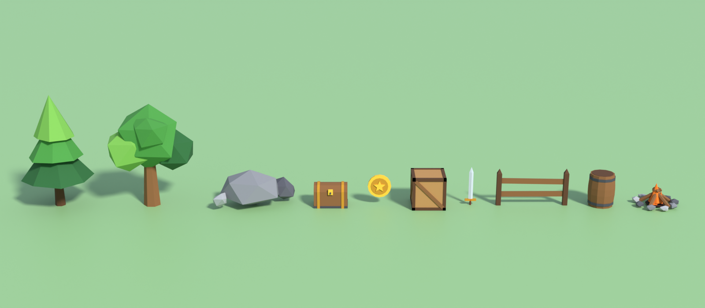

# Roblox low-poly asset pack



Ten stylised low-poly props made in Blender 5.2, ready to import into Roblox Studio.

| Asset | Triangles | Size (studs, approx.) | Notes |
|---|---|---|---|
| PineTree | 66 | 7 × 7 × 12 | |
| OakTree | 120 | 9 × 7 × 11 | |
| Rocks | 60 | 8 × 5 × 4 | Cluster of three rocks |
| TreasureChest | 168 | 3.6 × 2.6 × 2.6 | Two meshes: `Base` and `Lid` (lid can be animated open) |
| Coin | 280 | 2.5 × 0.5 × 2.5 | Origin at centre, good for spinning pickups |
| Crate | 204 | 3.6 × 3.6 × 3.6 | |
| Sword | 106 | 1.2 × 0.3 × 5 | Origin at the grip, for use as a Tool `Handle` |
| FenceSegment | 52 | 7.6 × 0.5 × 4 | Tile end to end every ~7.1 studs (2 m) |
| Barrel | 272 | 3 × 3 × 3.6 | |
| Campfire | 358 | 4.8 × 4.7 × 2.5 | Add a `Fire` or `PointLight` for the flames |

All assets are far below Roblox's per-mesh triangle limit.

## Files

- `fbx/` – one `.fbx` per asset with the texture embedded. **Use these for Roblox.**
- `glb/` – the same assets as glTF binary (also importable into Roblox and most engines).
- `textures/palette.png` – the shared colour palette texture (256×256).
- `previews/` – a render of each asset plus `showcase.png`.
- `source/generate_assets.py` – the Blender script that builds everything.
- `source/roblox_assets.blend` – the Blender scene.

## Importing into Roblox Studio

1. **Home → Import 3D** (or **File → Import 3D**) and choose a file from `fbx/`.
2. In the importer, check the preview size. If it looks wrong, set **File Dimensions** to **Meter**.
   Assets are modelled in metres, so 1 m ≈ 3.57 studs.
3. Click **Import**. You get a Model containing MeshPart(s) with the palette texture applied.
4. Anchor static props (trees, rocks, fences) so they don't fall over.

Every asset uses the same `palette.png`, so Roblox only uploads one texture for the whole pack.
To recolour an asset, edit the colour swatch in the palette, or change the colour values in
`PALETTE` at the top of the script and regenerate.

## Regenerating

```bash
pip install bpy            # Blender as a Python module (needs a Python version bpy supports)
python source/generate_assets.py roblox-assets
```

The script is deterministic (fixed random seed), so it rebuilds the same pack every time.
Add a new asset by writing a function that returns `[make_object(...)]` and adding it to `ASSETS`.
